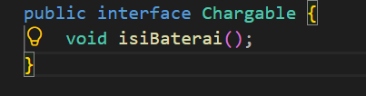
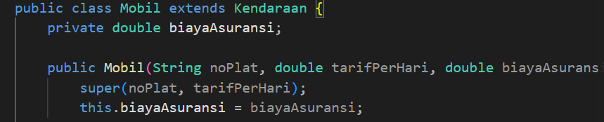
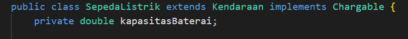
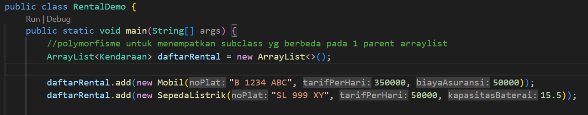

# Vehicle Rental System (Assignment 5 - Abstract Class & Interface)
---

### 1. Abstract Class & Abstract Method
* **Class Location:** `Kendaraan.java` (Line 2 & Line 18)

* **Explanation:** `Kendaraan` is declared as an `abstract class` to prevent direct instantiation. It defines an abstract method `public abstract double hitungBiayaSewa(int hari);` that forces all subclasses to provide their own specific rental calculation logic.

---

### 2. Interface & Interface Implementation
* **Class Location:** `Chargable.java` (Line 1) & `SepedaListrik.java` (Line 1 & Line 22–25)

* **Explanation:** `Chargable` is an interface declaring the `isiBaterai()` capability contract. It is implemented by `SepedaListrik` using the `implements` keyword without affecting regular non-electric vehicles like `Mobil`.

---

### 3. Inheritance
* **Class Location:** `Mobil.java` (Line 1 & Line 5) & `SepedaListrik.java` (Line 1 & Line 5)

* **Explanation:** Both `Mobil` and `SepedaListrik` extend the abstract class `Kendaraan` using the `extends` keyword and call the parent constructor using `super()`.

---

### 4. Polymorphism
* **Class Location:** `RentalDemo.java` (Lines 6–18)

* **Explanation:** Demonstrated using a polymorphic collection `ArrayList<Kendaraan>` that stores different vehicle subclasses. Calling `k.hitungBiayaSewa(2)` dynamically invokes the overridden method of the respective class at runtime. Interface capability is checked using the `instanceof` operator.

---